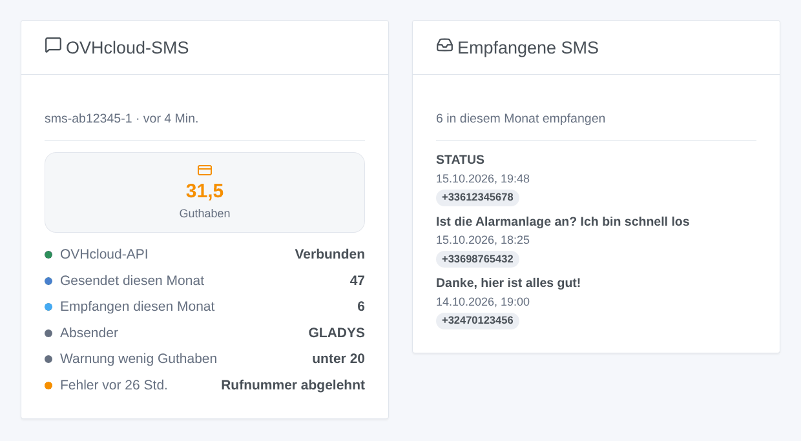
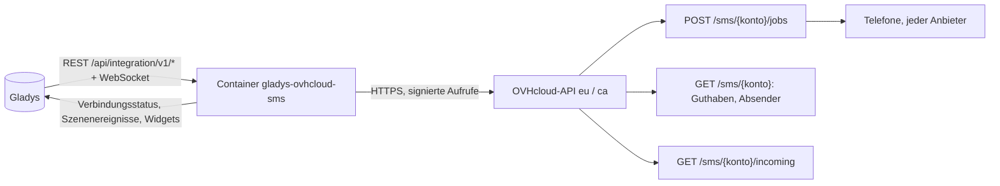
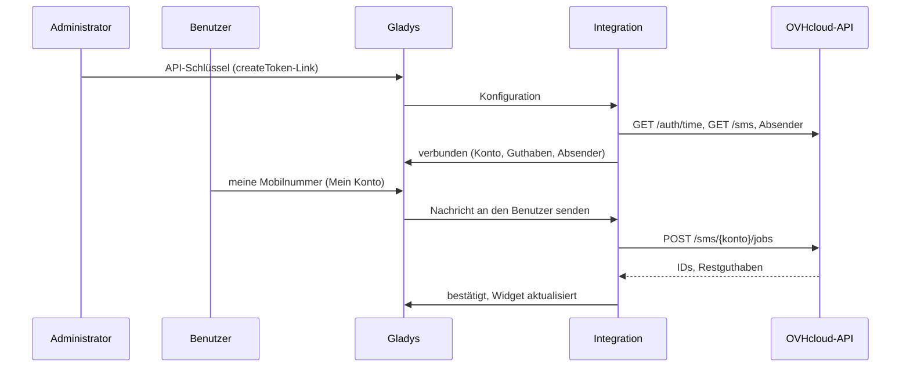

# Gladys OVHcloud SMS

[English](README.md) · [Français](README.fr.md) · **Deutsch** · [Español](README.es.md)

[](LICENSE)
[](https://github.com/William-De71/gladys-ovhcloud-sms/releases)
[](https://github.com/William-De71/gladys-ovhcloud-sms/actions/workflows/release.yml)
[](https://gladysassistant.com)


Externe Integration für [Gladys Assistant](https://gladysassistant.com), die die Benachrichtigungen von Gladys **per SMS über die SMS-API von OVHcloud** sendet, an jede Mobilnummer und jeden Anbieter. Szenen können außerdem jedem eine SMS senden, auf die auf dem Konto empfangenen SMS und auf wenig Guthaben reagieren, und zwei Dashboard-Widgets zeigen das Konto und die empfangenen SMS.

Benutzerdokumentation: [English](docs/en.md) · [Français](docs/fr.md) · [Deutsch](docs/de.md) · [Español](docs/es.md).

> Community-Integration, weder mit OVH SAS verbunden noch von ihr unterstützt.

## Funktionen

- **Benachrichtigungskanal** (nur Senden): Jeder Benutzer gibt seine Mobilnummer im Block „Mein Konto“ ein; jede an ihn gerichtete Gladys-Benachrichtigung geht per SMS raus.
- **Jeder Anbieter, jedes Land**, das das SMS-Konto erlaubt; nationale Nummern erhalten die Standard-Ländervorwahl.
- **Automatische Einrichtung**: das einzige SMS-Konto des OVHcloud-Kontos, sein erster aktiver Absender oder die Kurznummer, auf die Empfänger antworten können.
- **Szenenauslöser**: SMS nicht gesendet, SMS empfangen (Filter nach Absender und erstem Wort), wenig Guthaben.
- **Szenenaktionen**: eine SMS an eine beliebige Nummer senden, das SMS-Konto lesen.
- **Dashboard-Widgets**: SMS-Konto, empfangene SMS.
- **Schaltflächen der Konfiguration**: Verbindung testen, Test-SMS senden.
- Englisch, Französisch, Deutsch und Spanisch überall.



## Funktionsweise




Von der Konfiguration bis zur SMS:



Jeder Aufruf wird mit dem Application Secret und dem Consumer Key signiert (`X-Ovh-Signature`, das Verfahren der offiziellen OVHcloud-Clients) und mit der Serverzeit von OVHcloud versehen.

### Transport

`transports: ["cloud"]`: Die Integration spricht nur mit der OVHcloud-API (`eu.api.ovh.com` oder `ca.api.ovh.com`). Die Texte der SMS und die Rufnummern verlassen Ihr Netzwerk Richtung OVHcloud und dann zu den Mobilfunkanbietern.

## Benachrichtigungen und Rufnummern

| Eingegebene Nummer   | Gesendet an                                |
| -------------------- | ------------------------------------------ |
| `+33 6 12 34 56 78`  | `+33612345678`                             |
| `0033.6.12.34.56.78` | `+33612345678`                             |
| `06 12 34 56 78`     | `+33612345678` (Standard-Ländervorwahl 33) |
| `+32 470 12 34 56`   | `+32470123456`                             |

Der „STOP“-Hinweis, den OVHcloud an Werbe-SMS anhängt, wird nie hinzugefügt (`noStopClause`): Benachrichtigungen eines Hauses sind keine Werbung. Ein an eine Nachricht angehängtes Bild entfällt.

## Szenenauslöser, Aktionen und Widgets

| Art      | Schlüssel      | Anwendungsfall                                                                                |
| -------- | -------------- | --------------------------------------------------------------------------------------------- |
| Auslöser | `sms_not_sent` | Über einen anderen Kanal warnen, wenn keine SMS mehr rausgehen (Guthaben, Schlüssel, Ausfall) |
| Auslöser | `sms_received` | Auf eine SMS reagieren: eine Antwort, ein Stichwort wie STATUS von einer bekannten Nummer     |
| Auslöser | `credits_low`  | Das Konto aufladen, bevor es leer ist                                                         |
| Aktion   | `send_sms`     | SMS an jemanden ohne Gladys-Konto (Nachbar, Babysitter) oder an mehrere Nummern               |
| Aktion   | `get_account`  | Guthaben und SMS des Monats in einem Bericht oder einer Bedingung                             |
| Widget   | `account`      | Guthaben, Zustand der API, SMS des Monats, Absender, Schwelle, letzter Fehler                 |
| Widget   | `inbox`        | Die zuletzt empfangenen SMS                                                                   |

Beispiele: _Alarm wird ausgelöst_ → SMS an den Nachbarn; _wenig Guthaben_ → Nachricht an den Administrator; _SMS mit STATUS von meiner Nummer_ → mit den Temperaturen antworten. `sms_received` darf nie eine Tür öffnen oder eine Alarmanlage entschärfen: Der Absender einer SMS kann gefälscht sein. Eine Szenenaktion löst nie einen Auslöser aus, und `sms_not_sent` löst nur einmal aus, bis wieder eine SMS durchgeht: Eine Szene, die über denselben Kanal warnt, kann keine Schleife bilden.

## Voraussetzungen

- Gladys Assistant 5.3.0 oder neuer (Widgets und Szenen, Katalog-Suchbegriffe von Gladys 5.3); ältere Instanzen können die Integration nicht installieren.
- Ein OVHcloud-SMS-Konto mit Guthaben; optional ein freigegebener Absender, eine virtuelle Nummer zum Empfangen von SMS.

## Installation

- **Aus dem Store**: Integrationen → OVHcloud SMS → Installieren.
- **Über die URL des Repositorys**: Integrationen → externe Integration → `https://github.com/William-De71/gladys-ovhcloud-sms`.
- **Entwicklermodus**: Starten Sie `npm start` mit den von Gladys gelieferten Variablen (siehe Entwicklung).

## Konfiguration

| Feld                       | Standard | Bedeutung                                                                                    |
| -------------------------- | -------- | -------------------------------------------------------------------------------------------- |
| API-Region                 | Europa   | Europa oder Kanada                                                                           |
| Application Key            | —        | Seite zur Schlüsselerstellung (Rechte vorausgefüllt: GET /sms, GET /sms/_, POST /sms/_/jobs) |
| Application Secret         | —        | `secret`, verschlüsselt gespeichert                                                          |
| Consumer Key               | —        | `secret`, verschlüsselt gespeichert                                                          |
| SMS-Konto                  | auto     | `sms-xx12345-1`, wenn das OVHcloud-Konto mehrere hat                                         |
| Absender                   | auto     | Erster aktiver Absender oder die Kurznummer für Antworten                                    |
| Standard-Ländervorwahl     | 33       | Wird Nummern ohne Vorwahl vorangestellt                                                      |
| Warnung bei wenig Guthaben | 20       | Schwelle von `credits_low`                                                                   |
| Empfangene SMS lesen       | aus      | Alle 30 s, für `sms_received` und die empfangenen SMS                                        |
| Mein Konto → Nummer        | —        | Pro Benutzer: die Mobilnummer seiner Benachrichtigungen                                      |

## Verwendung

1. Erstellen Sie die Schlüssel über den Link Ihrer Region, füllen Sie die Konfiguration aus und klicken Sie dann auf **Verbindung testen** und **Test-SMS senden**.
2. Jeder Benutzer gibt seine Mobilnummer unter **Mein Konto** ein.
3. Fügen Sie die Widgets einem Dashboard hinzu und erstellen Sie Szenen mit den Auslösern und Aktionen.

## Entwicklung

```bash
npm install
npm test                       # node --test, nie mit Netzwerkzugriff
npm run lint                   # ESLint
npm run format:check           # Prettier
npx github:GladysAssistant/integration-store . --skip-image-check
scripts/build-cover.sh         # cover.jpg aus docs/assets/cover.svg
docs/illustrations/render.sh   # docs/assets/widgets.<sprache>.png
```

Lokal liest das SDK `GLADYS_HOST_API_URL`, `GLADYS_INTEGRATION_TOKEN` und `GLADYS_INTEGRATION_SELECTOR` (von Gladys im Entwicklermodus geliefert). `DEBUG=gladys-integration-sdk` zeigt die Protokolle des SDK.

Die Tests decken die Signatur (mit Python berechnete Referenzwerte), die Serverzeit und ihre Aktualisierung, die Fehlerarten, die Wahl von Konto und Absender, die Wiederholungen (nur 429 und 503), die Rufnummern, die Szenenereignisse und ihre Übergänge, die empfangenen SMS über einen Neustart hinweg, die Widgets (`validateWidgetContent`), das Manifest, die vier Sprachen, das Release-Skript und die ganze Integration gegen das Fake-Gladys des SDK und eine Fake-OVHcloud-API ab, die jede Signatur prüft. `test/structure.test.js` friert jeden von Benutzern gespeicherten Schlüssel ein.

## Release-Prozess


Jeder Merge auf `main` startet die CI und berechnet dann die Version aus den [Conventional Commits](https://www.conventionalcommits.org/de/) seit dem letzten Tag: `feat` → Minor, `fix` / `perf` → Patch, `!` oder `BREAKING CHANGE` → Major (ein Minor unter 1.0.0); `docs`, `chore`, `ci`, `test`, `style`, `refactor`, `build` allein veröffentlichen nichts. Der Changelog-Abschnitt wird generiert, der Tag gepusht, das Multi-Architektur-Image gebaut, dann erhält `main` den Release-Commit, die GitHub Release wird erstellt und ein letzter Job prüft das öffentliche Image, den Store-Validator und das Topic.

- Der Titel des Pull Requests wird zum Squash-Commit und dann zur Changelog-Zeile: Schreiben Sie ihn auf Englisch, für den Benutzer (`pr-title.yml` prüft ihn). Bearbeiten Sie `CHANGELOG.md` nie von Hand.
- 1.0.0 ist eine Entscheidung: Actions → Release → Run workflow mit `release-as: 1.0.0`. `dry-run` zeigt Version und Notizen, ohne zu veröffentlichen.
- **Geschützter Branch**: Die Release pusht ihren Commit mit `GITHUB_TOKEN` auf `main`. Mit einem Ruleset auf `main` fügen Sie GitHub Actions zu dessen Bypass-Liste hinzu (oder pushen über eine GitHub App), sonst schlägt der Veröffentlichungsjob mit Anweisungen fehl.
- Machen Sie nach der ersten Release das `ghcr.io`-Paket öffentlich (Package settings → Change visibility), sonst kann Gladys es nicht herunterladen.

## Fehlerbehebung

Siehe [docs/de.md](docs/de.md#fehlerbehebung). Melden Sie Probleme mit den Versionen von Gladys und der Integration, der API-Region, der Absenderart und den Protokollen der Integration (Rufnummern sind maskiert; fügen Sie nie die Schlüssel ein).

## Mitwirken

Issues und Pull Requests sind willkommen. Führen Sie `npm run format:check && npm run lint && npm test` aus, bevor Sie einen Pull Request öffnen, und ändern Sie keinen gespeicherten Schlüssel (siehe [CLAUDE.md](CLAUDE.md)).

## Sicherheit

Siehe [SECURITY.md](SECURITY.md): Melden Sie Schwachstellen vertraulich. Application Secret und Consumer Key sind `secret`-Felder, nie protokolliert, nie in einer URL, einem Szenenereignis oder einer Fehlermeldung; Rufnummern sind in den Protokollen maskiert. Der Consumer Key braucht nur drei Rechte (`GET /sms`, `GET /sms/*`, `POST /sms/*/jobs`), vom Erstellungslink vorausgefüllt. Ein Versand wird nach einer Zeitüberschreitung nie wiederholt, damit ein Alarm nicht doppelt gesendet wird.

## Kommende Screenshots

Die Bilder oben sind Illustrationen, keine Screenshots. Echte Screenshots kommen nach `docs/assets/screenshots/` (PNG, 1280 × 800): `configuration.png`, `my-account.png`, `scene-trigger.png`, `dashboard.png`.

## Lizenz

[Apache-Lizenz 2.0](LICENSE) — siehe auch [NOTICE](NOTICE). OVHcloud ist eine Marke der OVH SAS; diese Community-Integration ist nicht mit ihr verbunden. Danke an die Dokumentation und das SDK von Gladys.
