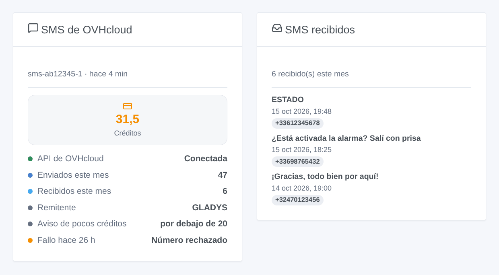
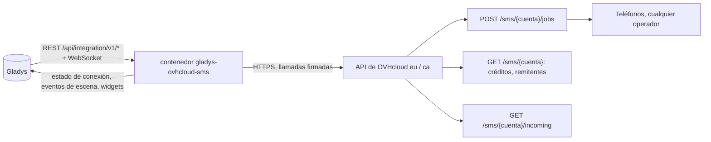
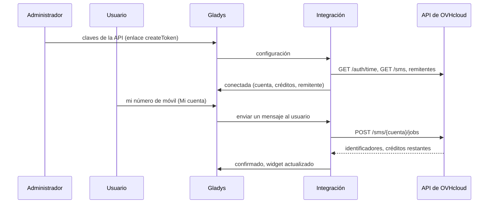

# Gladys OVHcloud SMS

[English](README.md) · [Français](README.fr.md) · [Deutsch](README.de.md) · **Español**

[](LICENSE)
[](https://github.com/William-De71/gladys-ovhcloud-sms/releases)
[](https://github.com/William-De71/gladys-ovhcloud-sms/actions/workflows/release.yml)
[](https://gladysassistant.com)


Integración externa para [Gladys Assistant](https://gladysassistant.com) que envía las notificaciones de Gladys **por SMS mediante la API SMS de OVHcloud**, a cualquier número de móvil y cualquier operador. Las escenas también pueden enviar un SMS a cualquiera, reaccionar a los SMS recibidos en la cuenta y a los pocos créditos, y dos widgets de panel muestran la cuenta y los SMS recibidos.

Documentación de usuario: [English](docs/en.md) · [Français](docs/fr.md) · [Deutsch](docs/de.md) · [Español](docs/es.md).

> Integración comunitaria, no afiliada a OVH SAS ni respaldada por ella.

## Funcionalidades

- **Canal de notificación** (solo envío): cada usuario introduce su número de móvil en el bloque «Mi cuenta»; toda notificación de Gladys dirigida a él sale por SMS.
- **Cualquier operador y país** que permita la cuenta SMS; los números nacionales reciben el prefijo por defecto.
- **Configuración automática**: la única cuenta SMS de la cuenta de OVHcloud, su primer remitente activo, o el número corto al que los destinatarios pueden responder.
- **Disparadores de escena**: SMS no enviado, SMS recibido (filtros por remitente y primera palabra), pocos créditos.
- **Acciones de escena**: enviar un SMS a cualquier número, leer la cuenta SMS.
- **Widgets de panel**: cuenta SMS, SMS recibidos.
- **Botones de la pantalla de configuración**: probar la conexión, enviar un SMS de prueba.
- Inglés, francés, alemán y español en todas partes.



## Funcionamiento




De la configuración a un SMS:



Cada llamada se firma con el secreto de aplicación y la clave de consumidor (`X-Ovh-Signature`, el esquema de los clientes oficiales de OVHcloud) y lleva la hora del servidor de OVHcloud.

### Transporte

`transports: ["cloud"]`: la integración solo habla con la API de OVHcloud (`eu.api.ovh.com` o `ca.api.ovh.com`). Los textos de los SMS y los números de teléfono salen de su red hacia OVHcloud y después hacia los operadores móviles.

## Notificaciones y números de teléfono

| Número escrito       | Enviado a                               |
| -------------------- | --------------------------------------- |
| `+33 6 12 34 56 78`  | `+33612345678`                          |
| `0033.6.12.34.56.78` | `+33612345678`                          |
| `06 12 34 56 78`     | `+33612345678` (prefijo por defecto 33) |
| `+32 470 12 34 56`   | `+32470123456`                          |

La mención «STOP» que OVHcloud añade a los SMS publicitarios no se añade nunca (`noStopClause`): las notificaciones de una casa no son publicidad. Una imagen adjunta a un mensaje se descarta.

## Disparadores, acciones de escena y widgets

| Tipo       | Clave          | Caso de uso                                                                                |
| ---------- | -------------- | ------------------------------------------------------------------------------------------ |
| Disparador | `sms_not_sent` | Avisar por otro canal cuando los SMS dejan de salir (créditos, claves, OVHcloud caído)     |
| Disparador | `sms_received` | Reaccionar a un SMS: una respuesta, una palabra clave como ESTADO desde un número conocido |
| Disparador | `credits_low`  | Recargar la cuenta antes de que se agote                                                   |
| Acción     | `send_sms`     | SMS a alguien que no es usuario de Gladys (vecino, niñera) o a varios números              |
| Acción     | `get_account`  | Créditos y SMS del mes en un informe o una condición                                       |
| Widget     | `account`      | Créditos, estado de la API, SMS del mes, remitente, umbral, último fallo                   |
| Widget     | `inbox`        | Los últimos SMS recibidos                                                                  |

Ejemplos: _salta la alarma_ → SMS al vecino; _pocos créditos_ → mensaje al administrador; _SMS que empieza por ESTADO desde mi número_ → responder con las temperaturas. `sms_received` nunca debe abrir una puerta ni desactivar una alarma: el remitente de un SMS puede falsificarse. Una acción de escena nunca activa un disparador, y `sms_not_sent` solo se activa una vez hasta que un SMS vuelve a pasar: una escena que avisa por este mismo canal no puede entrar en bucle.

## Requisitos previos

- Gladys Assistant 5.1.0 o posterior (widgets y escenas); las instancias más antiguas no pueden instalar la integración.
- Una cuenta SMS de OVHcloud con créditos; opcionalmente un remitente validado, un número virtual para recibir SMS.

## Instalación

- **Desde la tienda**: Integraciones → OVHcloud SMS → Instalar.
- **Desde la URL del repositorio**: Integraciones → integración externa → `https://github.com/William-De71/gladys-ovhcloud-sms`.
- **Modo desarrollador**: ejecute `npm start` con las variables que da Gladys (ver Desarrollo).

## Configuración

| Campo                        | Por defecto | Significado                                                                                |
| ---------------------------- | ----------- | ------------------------------------------------------------------------------------------ |
| Región de la API             | Europa      | Europa o Canadá                                                                            |
| Clave de aplicación          | —           | Página de creación de claves (permisos rellenados: GET /sms, GET /sms/_, POST /sms/_/jobs) |
| Secreto de aplicación        | —           | `secret`, guardado cifrado                                                                 |
| Clave de consumidor          | —           | `secret`, guardada cifrada                                                                 |
| Cuenta SMS                   | auto        | `sms-xx12345-1`, si la cuenta de OVHcloud tiene varias                                     |
| Remitente                    | auto        | Primer remitente activo, o el número corto para respuestas                                 |
| Prefijo del país por defecto | 33          | Se añade a los números escritos sin prefijo                                                |
| Aviso de pocos créditos      | 20          | Umbral de `credits_low`                                                                    |
| Leer los SMS recibidos       | no          | Cada 30 s, para `sms_received` y los SMS recibidos                                         |
| Mi cuenta → número           | —           | Por usuario: el número de móvil de sus notificaciones                                      |

## Uso

1. Cree las claves con el enlace de su región, rellene la configuración y pulse **Probar la conexión** y **Enviar un SMS de prueba**.
2. Cada usuario introduce su número de móvil en **Mi cuenta**.
3. Añada los widgets a un panel y cree escenas con los disparadores y las acciones.

## Desarrollo

```bash
npm install
npm test                       # node --test, nunca toca la red
npm run lint                   # ESLint
npm run format:check           # Prettier
npx github:GladysAssistant/integration-store . --skip-image-check
scripts/build-cover.sh         # cover.jpg a partir de docs/assets/cover.svg
docs/illustrations/render.sh   # docs/assets/widgets.<idioma>.png
```

En local, el SDK lee `GLADYS_HOST_API_URL`, `GLADYS_INTEGRATION_TOKEN` y `GLADYS_INTEGRATION_SELECTOR` (que da Gladys en modo desarrollador). `DEBUG=gladys-integration-sdk` muestra los registros del SDK.

Las pruebas cubren la firma (valores de referencia calculados con Python), la hora del servidor y su actualización, los tipos de error, la elección de la cuenta y del remitente, los reintentos (solo 429 y 503), los números de teléfono, los eventos de escena y sus transiciones, los SMS recibidos a través de un reinicio, los widgets (`validateWidgetContent`), el manifiesto, los cuatro idiomas, el script de release y toda la integración frente al Gladys falso del SDK y a una API de OVHcloud falsa que comprueba cada firma. `test/structure.test.js` congela cada clave que guardan los usuarios.

## Proceso de release


Cada fusión en `main` lanza la CI y calcula la versión a partir de los [Conventional Commits](https://www.conventionalcommits.org/es/) desde la última etiqueta: `feat` → menor, `fix` / `perf` → parche, `!` o `BREAKING CHANGE` → mayor (una menor por debajo de 1.0.0); `docs`, `chore`, `ci`, `test`, `style`, `refactor`, `build` solos no publican nada. Se genera la sección del changelog, se sube la etiqueta, se construye la imagen multiarquitectura, `main` recibe el commit de release, se crea la GitHub Release y un último job comprueba la imagen pública, el validador de la tienda y el topic.

- El título de la pull request se convierte en el commit squash y luego en la línea del changelog: escríbalo en inglés, para el usuario (`pr-title.yml` lo comprueba). No edite nunca `CHANGELOG.md` a mano.
- 1.0.0 es una decisión: Actions → Release → Run workflow con `release-as: 1.0.0`. `dry-run` muestra la versión y las notas sin publicar.
- **Rama protegida**: la release sube su commit a `main` con `GITHUB_TOKEN`. Con un ruleset en `main`, añada GitHub Actions a su lista de excepciones (o suba mediante una GitHub App); si no, el job de publicación falla con instrucciones.
- Tras la primera release, haga público el paquete `ghcr.io` (Package settings → Change visibility); si no, Gladys no puede descargarlo.

## Solución de problemas

Vea [docs/es.md](docs/es.md#solución-de-problemas). Informe de los problemas con las versiones de Gladys y de la integración, la región de la API, el tipo de remitente y los registros de la integración (los números aparecen enmascarados; no pegue nunca las claves).

## Contribuir

Las issues y pull requests son bienvenidas. Ejecute `npm run format:check && npm run lint && npm test` antes de abrir una pull request y no cambie ninguna clave guardada (vea [CLAUDE.md](CLAUDE.md)).

## Seguridad

Vea [SECURITY.md](SECURITY.md): informe de las vulnerabilidades en privado. El secreto de aplicación y la clave de consumidor son campos `secret`, nunca registrados, nunca en una URL, un evento de escena o un mensaje de error; los números aparecen enmascarados en los registros. La clave de consumidor solo necesita tres permisos (`GET /sms`, `GET /sms/*`, `POST /sms/*/jobs`), rellenados por el enlace de creación. Un envío nunca se reintenta tras un tiempo de espera agotado, para no enviar dos veces una alerta.

## Capturas pendientes

Las imágenes de arriba son ilustraciones, no capturas de pantalla. Las capturas reales irán en `docs/assets/screenshots/` (PNG, 1280 × 800): `configuration.png`, `my-account.png`, `scene-trigger.png`, `dashboard.png`.

## Licencia

[Licencia Apache 2.0](LICENSE) — vea también [NOTICE](NOTICE). OVHcloud es una marca de OVH SAS; esta integración comunitaria no está afiliada a ella. Gracias a la documentación y al SDK de Gladys.
