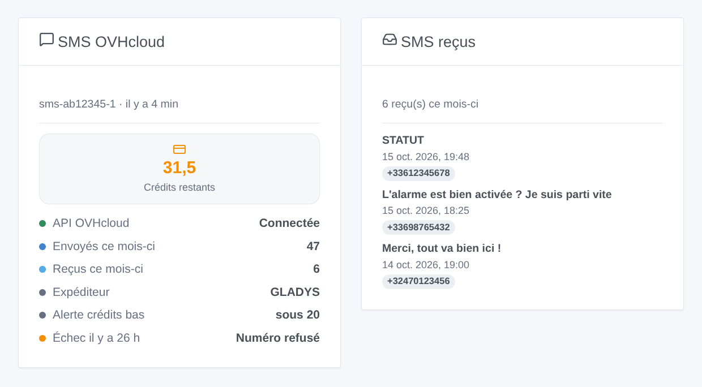
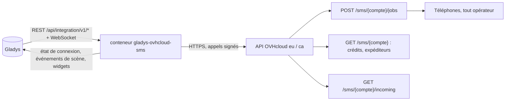
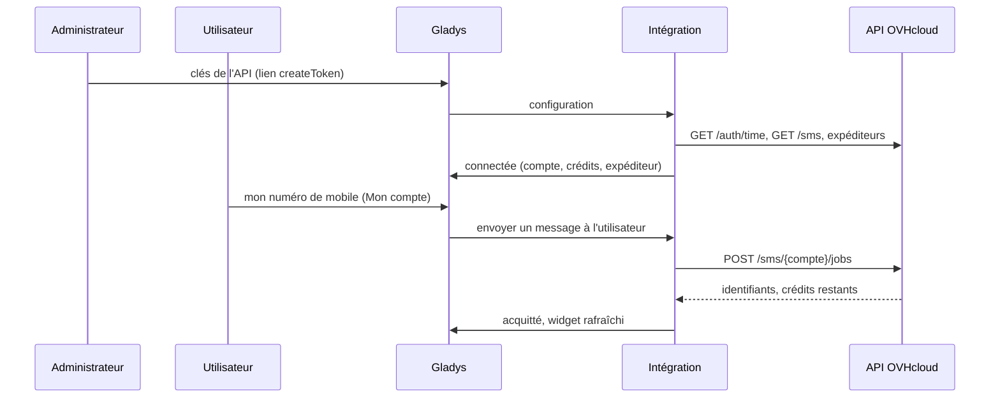

# Gladys OVHcloud SMS

[English](README.md) · **Français** · [Deutsch](README.de.md) · [Español](README.es.md)

[](LICENSE)
[](https://github.com/William-De71/gladys-ovhcloud-sms/releases)
[](https://github.com/William-De71/gladys-ovhcloud-sms/actions/workflows/release.yml)
[](https://gladysassistant.com)


Intégration externe pour [Gladys Assistant](https://gladysassistant.com) qui envoie les notifications de Gladys **par SMS grâce à l'API SMS d'OVHcloud**, vers n'importe quel numéro de mobile et n'importe quel opérateur. Les scènes peuvent aussi envoyer un SMS à n'importe qui, réagir aux SMS reçus sur le compte et aux crédits bas, et deux widgets de tableau de bord affichent le compte et les SMS reçus.

Documentation utilisateur : [English](docs/en.md) · [Français](docs/fr.md) · [Deutsch](docs/de.md) · [Español](docs/es.md).

> Intégration communautaire, ni affiliée à OVH SAS ni approuvée par elle.

## Fonctionnalités

- **Canal de notification** (envoi seul) : chaque utilisateur saisit son numéro de mobile dans le bloc « Mon compte » ; toute notification Gladys qui lui est adressée part par SMS.
- **Tout opérateur, tout pays** autorisé par le compte SMS ; les numéros nationaux reçoivent l'indicatif par défaut.
- **Réglage automatique** : l'unique compte SMS du compte OVHcloud, son premier expéditeur actif, ou le numéro court auquel les destinataires peuvent répondre.
- **Déclencheurs de scène** : SMS non envoyé, SMS reçu (filtres sur l'expéditeur et le premier mot), crédits bas.
- **Actions de scène** : envoyer un SMS à n'importe quel numéro, lire le compte SMS.
- **Widgets de tableau de bord** : compte SMS, SMS reçus.
- **Boutons de l'écran de configuration** : tester la connexion, envoyer un SMS de test.
- Anglais, français, allemand et espagnol partout.



## Fonctionnement




De la configuration à un SMS :



Chaque appel est signé avec le secret d'application et la clé consommateur (`X-Ovh-Signature`, le schéma des clients officiels d'OVHcloud) et horodaté avec l'heure du serveur OVHcloud.

### Transport

`transports: ["cloud"]` : l'intégration ne parle qu'à l'API OVHcloud (`eu.api.ovh.com` ou `ca.api.ovh.com`). Les textes des SMS et les numéros de téléphone quittent votre réseau vers OVHcloud, puis les opérateurs mobiles.

## Notifications et numéros de téléphone

| Numéro saisi         | Envoyé à                                 |
| -------------------- | ---------------------------------------- |
| `+33 6 12 34 56 78`  | `+33612345678`                           |
| `0033.6.12.34.56.78` | `+33612345678`                           |
| `06 12 34 56 78`     | `+33612345678` (indicatif par défaut 33) |
| `+32 470 12 34 56`   | `+32470123456`                           |

La mention « STOP » qu'OVHcloud ajoute aux SMS publicitaires n'est jamais ajoutée (`noStopClause`) : les notifications d'une maison ne sont pas de la publicité. Une image jointe à un message est ignorée.

## Déclencheurs, actions de scène et widgets

| Type        | Clé            | Cas d'usage                                                                                  |
| ----------- | -------------- | -------------------------------------------------------------------------------------------- |
| Déclencheur | `sms_not_sent` | Prévenir par un autre canal quand les SMS ne partent plus (crédits, clés, OVHcloud en panne) |
| Déclencheur | `sms_received` | Réagir à un SMS : une réponse, un mot-clé comme STATUT depuis un numéro connu                |
| Déclencheur | `credits_low`  | Recharger le compte avant qu'il soit vide                                                    |
| Action      | `send_sms`     | SMS à quelqu'un qui n'est pas utilisateur de Gladys (voisin, nounou), ou à plusieurs numéros |
| Action      | `get_account`  | Crédits et SMS du mois dans un compte rendu ou une condition                                 |
| Widget      | `account`      | Crédits, état de l'API, SMS du mois, expéditeur, seuil, dernier échec                        |
| Widget      | `inbox`        | Les derniers SMS reçus                                                                       |

Exemples : _l'alarme se déclenche_ → SMS au voisin ; _crédits bas_ → message à l'administrateur ; _SMS commençant par STATUT depuis mon numéro_ → répondre avec les températures. `sms_received` ne doit jamais ouvrir une porte ni désarmer une alarme : l'expéditeur d'un SMS peut être falsifié. Une action de scène ne déclenche jamais de déclencheur, et `sms_not_sent` ne se déclenche qu'une fois jusqu'à ce qu'un SMS repasse : une scène qui prévient par ce même canal ne peut pas boucler.

## Prérequis

- Gladys Assistant 5.1.0 ou plus récent (widgets et scènes) ; les instances plus anciennes ne peuvent pas installer l'intégration.
- Un compte SMS OVHcloud avec des crédits ; en option un expéditeur validé, un numéro virtuel pour recevoir des SMS.

## Installation

- **Depuis le store** : Intégrations → OVHcloud SMS → Installer.
- **Depuis l'URL du dépôt** : Intégrations → intégration externe → `https://github.com/William-De71/gladys-ovhcloud-sms`.
- **Mode développeur** : lancez `npm start` avec les variables données par Gladys (voir Développement).

## Configuration

| Champ                        | Défaut | Rôle                                                                                    |
| ---------------------------- | ------ | --------------------------------------------------------------------------------------- |
| Région de l'API              | Europe | Europe ou Canada                                                                        |
| Clé d'application            | —      | Page de création des clés (droits pré-remplis : GET /sms, GET /sms/_, POST /sms/_/jobs) |
| Secret d'application         | —      | `secret`, stocké chiffré                                                                |
| Clé consommateur             | —      | `secret`, stockée chiffrée                                                              |
| Compte SMS                   | auto   | `sms-xx12345-1`, si le compte OVHcloud en a plusieurs                                   |
| Expéditeur                   | auto   | Premier expéditeur actif, ou le numéro court pour les réponses                          |
| Indicatif du pays par défaut | 33     | Ajouté aux numéros saisis sans indicatif                                                |
| Alerte de crédits bas        | 20     | Seuil de `credits_low`                                                                  |
| Lire les SMS reçus           | non    | Toutes les 30 s, pour `sms_received` et les SMS reçus                                   |
| Mon compte → numéro          | —      | Par utilisateur : le numéro de mobile de ses notifications                              |

## Utilisation

1. Créez les clés avec le lien de votre région, remplissez la configuration, puis cliquez sur **Tester la connexion** et **Envoyer un SMS de test**.
2. Chaque utilisateur saisit son numéro de mobile dans **Mon compte**.
3. Ajoutez les widgets à un tableau de bord, et créez des scènes avec les déclencheurs et les actions.

## Développement

```bash
npm install
npm test                       # node --test, ne touche jamais le réseau
npm run lint                   # ESLint
npm run format:check           # Prettier
npx github:GladysAssistant/integration-store . --skip-image-check
scripts/build-cover.sh         # cover.jpg depuis docs/assets/cover.svg
docs/illustrations/render.sh   # docs/assets/widgets.<langue>.png
```

En local, le SDK lit `GLADYS_HOST_API_URL`, `GLADYS_INTEGRATION_TOKEN` et `GLADYS_INTEGRATION_SELECTOR` (donnés par Gladys en mode développeur). `DEBUG=gladys-integration-sdk` affiche les journaux du SDK.

Les tests couvrent la signature (valeurs de référence calculées avec Python), l'heure du serveur et son rafraîchissement, les types d'erreur, le choix du compte et de l'expéditeur, les nouvelles tentatives (429 et 503 seulement), les numéros de téléphone, les événements de scène et leurs transitions, les SMS reçus à travers un redémarrage, les widgets (`validateWidgetContent`), le manifeste, les quatre langues, le script de release, et toute l'intégration face au faux Gladys du SDK et à une fausse API OVHcloud qui vérifie chaque signature. `test/structure.test.js` fige chaque clé stockée par les utilisateurs.

## Processus de release


Chaque fusion sur `main` lance la CI, puis calcule la version à partir des [Conventional Commits](https://www.conventionalcommits.org/fr/) depuis le dernier tag : `feat` → mineure, `fix` / `perf` → correctif, `!` ou `BREAKING CHANGE` → majeure (une mineure sous 1.0.0) ; `docs`, `chore`, `ci`, `test`, `style`, `refactor`, `build` seuls ne publient rien. La section du changelog est générée, le tag poussé, l'image multi-architecture construite, puis `main` reçoit le commit de release, la GitHub Release est créée et un dernier job vérifie l'image publique, le validateur du store et le topic.

- Le titre de la pull request devient le commit squash, puis la ligne du changelog : écrivez-le en anglais, pour l'utilisateur (`pr-title.yml` le vérifie). N'éditez jamais `CHANGELOG.md` à la main.
- 1.0.0 est une décision : Actions → Release → Run workflow avec `release-as: 1.0.0`. `dry-run` montre la version et les notes sans rien publier.
- **Branche protégée** : la release pousse son commit sur `main` avec `GITHUB_TOKEN`. Avec un ruleset sur `main`, ajoutez GitHub Actions à sa liste de contournement (ou poussez via une GitHub App), sinon le job de publication échoue avec des instructions.
- Après la première release, rendez public le package `ghcr.io` (Package settings → Change visibility), sinon Gladys ne peut pas le télécharger.

## Dépannage

Voir [docs/fr.md](docs/fr.md#dépannage). Signalez un problème avec les versions de Gladys et de l'intégration, la région de l'API, le type d'expéditeur et les journaux de l'intégration (les numéros sont masqués ; ne collez jamais les clés).

## Contribuer

Les issues et pull requests sont bienvenues. Lancez `npm run format:check && npm run lint && npm test` avant d'ouvrir une pull request, et ne changez aucune clé stockée (voir [CLAUDE.md](CLAUDE.md)).

## Sécurité

Voir [SECURITY.md](SECURITY.md) : signalez les vulnérabilités en privé. Le secret d'application et la clé consommateur sont des champs `secret`, jamais journalisés, jamais dans une URL, un événement de scène ou un message d'erreur ; les numéros sont masqués dans les journaux. La clé consommateur n'a besoin que de trois droits (`GET /sms`, `GET /sms/*`, `POST /sms/*/jobs`), pré-remplis par le lien de création. Un envoi n'est jamais retenté après un délai dépassé, pour ne pas envoyer deux fois une alerte.

## Captures à venir

Les images ci-dessus sont des illustrations, pas des captures d'écran. Les vraies captures iront dans `docs/assets/screenshots/` (PNG, 1280 × 800) : `configuration.png`, `my-account.png`, `scene-trigger.png`, `dashboard.png`.

## Licence

[Licence Apache 2.0](LICENSE) — voir aussi [NOTICE](NOTICE). OVHcloud est une marque d'OVH SAS ; cette intégration communautaire n'y est pas affiliée. Merci à la documentation et au SDK de Gladys.
