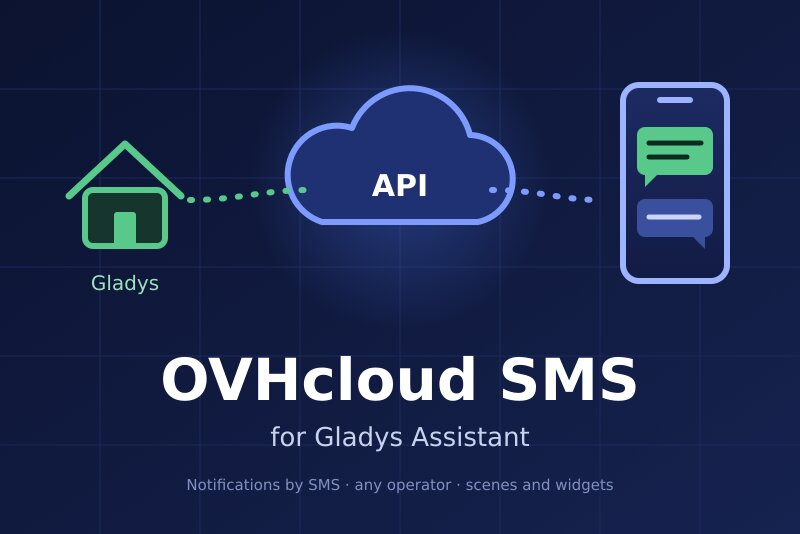
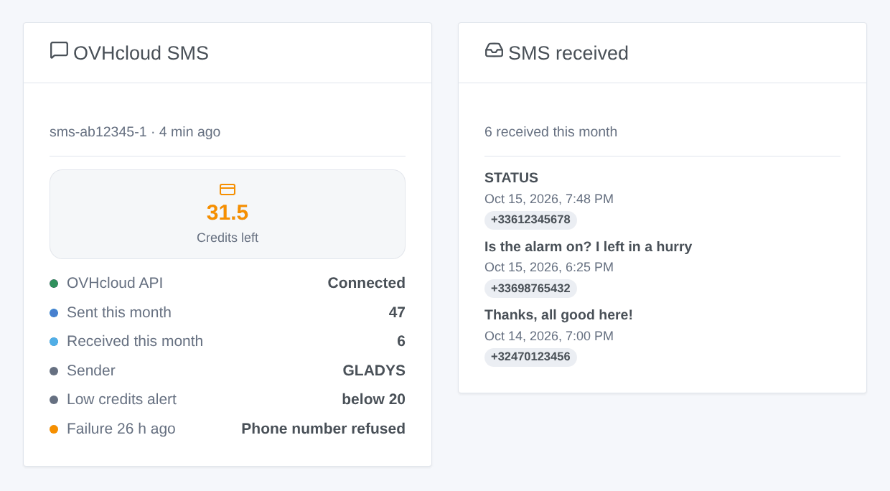
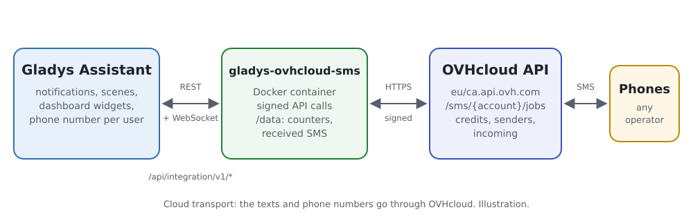
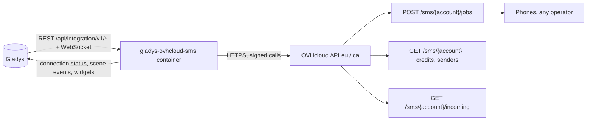
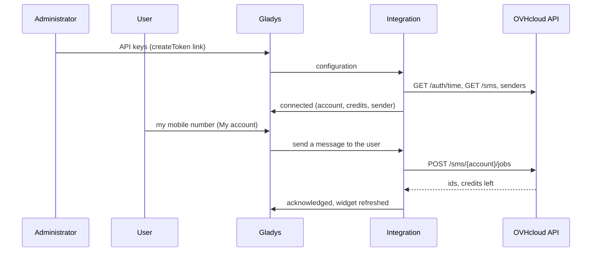

# Gladys OVHcloud SMS

**English** · [Français](README.fr.md) · [Deutsch](README.de.md) · [Español](README.es.md)

[](LICENSE)
[](https://github.com/William-De71/gladys-ovhcloud-sms/releases)
[](https://github.com/William-De71/gladys-ovhcloud-sms/actions/workflows/release.yml)
[](https://gladysassistant.com)



[Gladys Assistant](https://gladysassistant.com) external integration that sends the notifications of Gladys **by SMS through the OVHcloud SMS API**, to any mobile number and any operator. Scenes can also send an SMS to anyone, react to the SMS received on the account and to low credits, and two dashboard widgets show the account and the inbox.

User documentation: [English](docs/en.md) · [Français](docs/fr.md) · [Deutsch](docs/de.md) · [Español](docs/es.md).

> Community integration, not affiliated with nor endorsed by OVH SAS.

## Features

- **Notification channel** (send-only): each user enters their mobile number in the "My account" block; every Gladys notification addressed to them leaves by SMS.
- **Any operator, any country** the SMS account allows; national numbers get the default country code.
- **Automatic setup**: the only SMS account of the OVHcloud account, its first enabled sender, or the short number recipients can reply to.
- **Scene triggers**: SMS not sent, SMS received (filters on the sender and the first word), credits low.
- **Scene actions**: send an SMS to any number, read the SMS account.
- **Dashboard widgets**: SMS account, SMS received.
- **Configuration screen buttons**: test the connection, send a test SMS.
- English, French, German and Spanish everywhere.



## How it works





From the configuration to an SMS:



Each call is signed with the application secret and the consumer key (`X-Ovh-Signature`, the scheme of the official OVHcloud clients) and stamped with the OVHcloud server time.

### Transport

`transports: ["cloud"]`: the integration only talks to the OVHcloud API (`eu.api.ovh.com` or `ca.api.ovh.com`). The texts of the SMS and the phone numbers leave your network for OVHcloud, then the mobile operators.

## Notifications and phone numbers

| Typed number         | Sent to                                  |
| -------------------- | ---------------------------------------- |
| `+33 6 12 34 56 78`  | `+33612345678`                           |
| `0033.6.12.34.56.78` | `+33612345678`                           |
| `06 12 34 56 78`     | `+33612345678` (default country code 33) |
| `+32 470 12 34 56`   | `+32470123456`                           |

The "STOP" mention OVHcloud adds to advertising SMS is never added (`noStopClause`): home notifications are not advertising. A picture attached to a message is dropped.

## Scene triggers, actions and widgets

| Kind    | Key            | Use case                                                                              |
| ------- | -------------- | ------------------------------------------------------------------------------------- |
| Trigger | `sms_not_sent` | Warn through another channel when SMS stop leaving (credits, keys, OVHcloud down)     |
| Trigger | `sms_received` | React to an SMS: a reply, a keyword such as STATUS from a known number                |
| Trigger | `credits_low`  | Top up the account before it runs dry                                                 |
| Action  | `send_sms`     | SMS to someone who is not a Gladys user (neighbor, babysitter), or to several numbers |
| Action  | `get_account`  | Credits and SMS of the month in a report or a condition                               |
| Widget  | `account`      | Credits, API state, SMS of the month, sender, threshold, last failure                 |
| Widget  | `inbox`        | The last SMS received                                                                 |

Examples: _alarm goes off_ → SMS to the neighbor; _credits low_ → message to the administrator; _SMS starting with STATUS from my number_ → answer with the temperatures. `sms_received` must never open a door or disarm an alarm: an SMS sender can be forged. A scene action never fires a trigger, and `sms_not_sent` fires once until an SMS goes through: a scene warning through this same channel cannot loop.

## Requirements

- Gladys Assistant 5.1.0 or later (widgets and scenes); older instances cannot install the integration.
- An OVHcloud SMS account with credits; optionally an approved sender, a virtual number to receive SMS.

## Installation

- **From the store**: Integrations → OVHcloud SMS → Install.
- **From the repository URL**: Integrations → external integration → `https://github.com/William-De71/gladys-ovhcloud-sms`.
- **Developer mode**: run `npm start` with the variables given by Gladys (see Development).

## Configuration

| Field                 | Default | Meaning                                                                                |
| --------------------- | ------- | -------------------------------------------------------------------------------------- |
| API region            | Europe  | Europe or Canada                                                                       |
| Application key       | —       | From the key creation page (pre-filled rights: GET /sms, GET /sms/_, POST /sms/_/jobs) |
| Application secret    | —       | `secret`, stored encrypted                                                             |
| Consumer key          | —       | `secret`, stored encrypted                                                             |
| SMS account           | auto    | `sms-xx12345-1`, when the OVHcloud account has several                                 |
| Sender                | auto    | First enabled sender, or the short number for replies                                  |
| Default country code  | 33      | Added to numbers typed without one                                                     |
| Low credits alert     | 20      | Threshold of `credits_low`                                                             |
| Read the SMS received | off     | Every 30 s, for `sms_received` and the inbox                                           |
| My account → number   | —       | Per user: the mobile number of their notifications                                     |

## Usage

1. Create the keys with the link of your region, fill in the configuration, then click **Test the connection** and **Send a test SMS**.
2. Each user enters their mobile number in **My account**.
3. Add the widgets to a dashboard, and build scenes with the triggers and actions.

## Development

```bash
npm install
npm test                       # node --test, never touches the network
npm run lint                   # ESLint
npm run format:check           # Prettier
npx github:GladysAssistant/integration-store . --skip-image-check
scripts/build-cover.sh         # cover.jpg from docs/assets/cover.svg
docs/illustrations/render.sh   # docs/assets/widgets.<lang>.png
```

Locally, the SDK reads `GLADYS_HOST_API_URL`, `GLADYS_INTEGRATION_TOKEN` and `GLADYS_INTEGRATION_SELECTOR` (given by Gladys in developer mode). `DEBUG=gladys-integration-sdk` shows the SDK logs.

The tests cover the signature (reference values computed with Python), the server time and its refresh, the error kinds, the resolution of the account and the sender, the retries (429 and 503 only), the phone numbers, the scene events and their transitions, the received SMS across a restart, the widgets (`validateWidgetContent`), the manifest, the four languages, the release script, and the whole integration against the fake Gladys of the SDK and a fake OVHcloud API that checks every signature. `test/structure.test.js` freezes every key users store.

## Release process


Every merge on `main` runs the CI, then computes the version from the [Conventional Commits](https://www.conventionalcommits.org/) since the last tag: `feat` → minor, `fix` / `perf` → patch, `!` or `BREAKING CHANGE` → major (a minor below 1.0.0); `docs`, `chore`, `ci`, `test`, `style`, `refactor`, `build` alone publish nothing. The changelog section is generated, the tag pushed, the multi-architecture image built, then `main` receives the release commit, the GitHub Release is created and a last job checks the public image, the store validator and the topic.

- The pull request title becomes the squash commit, then the changelog line: write it in English, for the user (`pr-title.yml` checks it). Never edit `CHANGELOG.md` by hand.
- 1.0.0 is a decision: Actions → Release → Run workflow with `release-as: 1.0.0`. `dry-run` shows the version and the notes without publishing.
- **Protected branch**: the release pushes its commit to `main` with `GITHUB_TOKEN`. With a ruleset on `main`, add GitHub Actions to its bypass list (or push through a GitHub App), otherwise the publish job fails with instructions.
- After the first release, make the `ghcr.io` package public (Package settings → Change visibility), or Gladys cannot pull it.

## Troubleshooting

See [docs/en.md](docs/en.md#troubleshooting). Report issues with the versions of Gladys and of the integration, the API region, the kind of sender and the logs of the integration (phone numbers are masked; never paste the keys).

## Contributing

Issues and pull requests are welcome. Run `npm run format:check && npm run lint && npm test` before opening a pull request, and keep every stored key unchanged (see [CLAUDE.md](CLAUDE.md)).

## Security

See [SECURITY.md](SECURITY.md): report vulnerabilities privately. The application secret and the consumer key are `secret` fields, never logged, never in a URL, a scene event or an error message; phone numbers are masked in the logs. The consumer key only needs three rights (`GET /sms`, `GET /sms/*`, `POST /sms/*/jobs`), pre-filled by the creation link. A send is never retried after a timeout, so an alert is not sent twice.

## Screenshots to come

The images above are illustrations, not screenshots. Real screenshots will go in `docs/assets/screenshots/` (PNG, 1280 × 800): `configuration.png`, `my-account.png`, `scene-trigger.png`, `dashboard.png`.

## License

[Apache License 2.0](LICENSE) — see also [NOTICE](NOTICE). OVHcloud is a trademark of OVH SAS; this community integration is not affiliated with it. Thanks to the Gladys documentation and SDK.
